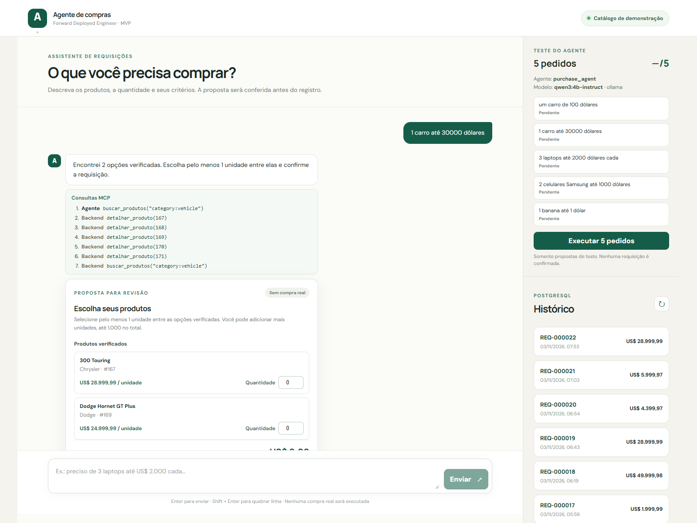
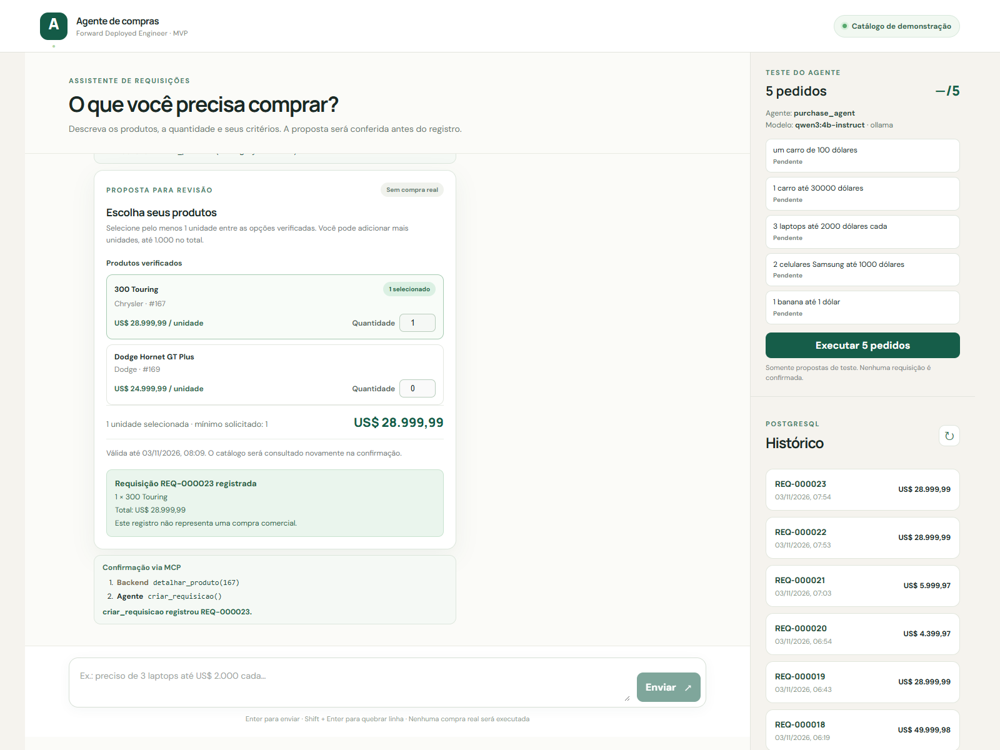

# Agente de compras FDE

MVP de requisições de compra em linguagem natural. O agente Go com Google ADK consulta um catálogo de demonstração por MCP; o backend valida os produtos, calcula os valores em USD e grava a requisição no PostgreSQL somente após confirmação explícita. O registro **não realiza uma compra comercial**.

## Demonstração

Capturas de um pedido de carro no modo local com Ollama e catálogo DummyJSON. A proposta mostra as opções verificadas e as chamadas MCP; após a confirmação, o backend revalida o produto e registra a requisição no PostgreSQL.

**Proposta e ferramentas utilizadas**



**Requisição confirmada e histórico**



## Uso de IA no desenvolvimento

Utilizei o **Codex (ChatGPT)** como ferramenta de produtividade para implementar funcionalidades, organizar o código, criar testes e investigar falhas. Antes da implementação, defini a arquitetura, as tecnologias e as responsabilidades de cada componente. Mantive a API que conversa com o LLM e o servidor MCP em serviços Go separados para deixar clara a divisão entre interpretação do pedido, consulta ao catálogo e persistência. A escolha de Go também veio do contato com a linguagem durante a entrevista.

As principais tecnologias são **Go e Google ADK** para o agente, **MCP** para as ferramentas `buscar_produtos`, `detalhar_produto` e `criar_requisicao`, **DummyJSON** como catálogo de demonstração, **PostgreSQL** para propostas e requisições, **React** na interface e **Docker Compose** para executar os serviços. Na persistência, usei `pgxpool`: cada serviço Go mantém seu próprio pool de conexões e o reutiliza nas operações com o PostgreSQL. O LLM interpreta o pedido e escolhe ferramentas; o backend valida produtos e quantidades, calcula valores e controla a gravação após a confirmação do usuário.

Trabalhei com o Codex em ciclos de implementação de até aproximadamente 1.000 linhas antes de uma revisão humana. Ao fim de cada ciclo, analisava o resultado, testava cenários reais e enviava instruções para corrigir problemas ou fazer ajustes específicos. Mantive sob minha responsabilidade as decisões técnicas e a evolução do projeto.

### Escolha do modelo

Planejei inicialmente usar Gemini por meio do OpenRouter, mas tive problemas com a chave de API disponível. Testei modelos gratuitos, incluindo Gemma, e encontrei limites de requisições e respostas inconsistentes para a integração de _tool calling_ com ADK Go. Para continuar os testes sem custo por chamada, passei a usar **Ollama** localmente. O **Qwen 2.5** ajudou a avançar nas primeiras iterações; a configuração padrão atual usa **`qwen3:4b-instruct`**. O OpenRouter continua configurável para uma etapa futura.

### Testes e melhorias

Usei o Codex para apoiar a criação e execução de testes, inclusive cenários de erro e casos de borda. Também testei conversas manualmente e corrigi situações em que o agente repetia perguntas, perdia o contexto ou sugeria produtos fora dos critérios. Com o fluxo principal funcional, acrescentei:

- **Ferramentas no chat:** a interface mostra as chamadas MCP do agente e as verificações feitas pelo backend.
- **Avaliação com cinco pedidos:** script e painel exibem os resultados por caso e o número de acertos.
- **CI:** verificações automáticas de formatação, `go vet`, testes Go e build do frontend.
- **`criar_requisicao`:** terceira ferramenta MCP, disponível ao agente após confirmação explícita; o servidor valida os dados, calcula o total e grava a requisição no PostgreSQL.

Com mais tempo, priorizaria melhorias visuais, mais cenários de teste e uma avaliação mais abrangente das respostas para aumentar a consistência do agente.

## Início rápido: modelo local, sem chave de API

Este é o caminho recomendado para avaliar o projeto. Docker executa frontend, API Go, servidor MCP e PostgreSQL; [Ollama](https://ollama.com/download) executa o modelo no computador. A API cria as tabelas automaticamente ao iniciar. A busca de produtos usa a DummyJSON pela internet, então é necessário acesso à rede durante o teste.

### 1. Prepare o computador

- Instale Git, Docker Desktop (Windows/macOS) ou Docker Engine com Compose v2 (Linux) e deixe o Docker em execução. Confira com `docker compose version` e `docker info`.
- Instale e inicie Ollama. Confira com `ollama --version`. O modelo padrão, `qwen3:4b-instruct`, ocupa aproximadamente 2,5 GB para download; reserve espaço e memória para executá-lo.
- Para obter o código, execute em um terminal:

```sh
git clone https://github.com/picolitios/agente-de-compras-fde.git
cd agente-de-compras-fde
```

Se você recebeu a pasta do projeto por outro meio, entre nela e continue. A branch `main` contém a versão pronta para avaliação. Não é necessário instalar Go, Node ou PostgreSQL no computador para o caminho com Docker.

### 2. Configure as variáveis locais

Crie o arquivo `.env` a partir do exemplo:

| Terminal             | Comando                       |
| -------------------- | ----------------------------- |
| PowerShell (Windows) | `Copy-Item .env.example .env` |
| macOS/Linux          | `cp .env.example .env`        |

Abra `.env` no editor de sua preferência e substitua **todos** os valores `replace-me` relevantes ao modo local:

```dotenv
OPENROUTER_API_KEY=
POSTGRES_PASSWORD=SENHA_ALFANUMERICA_FORTE
DATABASE_URL=postgres://purchases:SENHA_ALFANUMERICA_FORTE@db:5432/purchases?sslmode=disable
MCP_WRITE_SECRET=SEGREDO_ALEATORIO_COM_PELO_MENOS_32_CARACTERES
```

Use a **mesma senha** nas linhas `POSTGRES_PASSWORD` e `DATABASE_URL`. Para simplificar a URL, escolha uma senha alfanumérica; caracteres especiais exigem codificação de URL. `MCP_WRITE_SECRET` precisa ter ao menos 32 caracteres aleatórios. Você pode gerá-lo com um gerenciador de senhas, `openssl rand -hex 32` no macOS/Linux ou este comando no PowerShell:

```powershell
$bytes = New-Object byte[] 32
[System.Security.Cryptography.RandomNumberGenerator]::Create().GetBytes($bytes)
([BitConverter]::ToString($bytes)).Replace('-', '')
```

Copie o valor gerado para o `.env`; não o coloque em commits, issues ou capturas de tela. O arquivo já está no `.gitignore`. `OPENROUTER_API_KEY` pode ficar vazio: o Compose padrão usa Ollama e não envia essa variável à API.

### 3. Baixe e confira o modelo

No Windows/macOS, abra o aplicativo Ollama. No Linux, inicie o serviço Ollama antes do comando abaixo. Em seguida, execute:

```sh
ollama pull qwen3:4b-instruct
ollama list
```

Confirme que `qwen3:4b-instruct` aparece na lista. Se o Ollama estiver desligado, a API poderá subir, mas o chat responderá que o modelo está indisponível.

**Linux:** o contêiner precisa alcançar o Ollama no host. Se você usa o Ollama via CLI, inicie-o em outro terminal com `OLLAMA_HOST=0.0.0.0:11434 ollama serve` antes de baixar o modelo. Se usa o serviço systemd, execute `sudo systemctl edit ollama.service`, adicione as linhas abaixo, salve e execute `sudo systemctl daemon-reload` e `sudo systemctl restart ollama`:

```ini
[Service]
Environment="OLLAMA_HOST=0.0.0.0:11434"
```

Restrinja a porta 11434 no firewall à máquina local/rede Docker. Nos comandos Docker abaixo, acrescente `-f compose.yaml -f compose.linux.yaml` depois de `docker compose`. Windows/macOS com Docker Desktop usam somente `compose.yaml`. Consulte a [configuração oficial do Ollama](https://docs.ollama.com/faq) e a [explicação do Docker sobre `host-gateway`](https://docs.docker.com/compose/how-tos/networking/) se precisar adaptar a rede.

### 4. Suba o projeto

Na raiz do projeto, execute:

```sh
docker compose config -q
docker compose up --build -d
docker compose ps
```

No Linux, use `docker compose -f compose.yaml -f compose.linux.yaml` nos três comandos. Aguarde `db` e `api` aparecerem como **healthy** em `docker compose ps`; a primeira execução pode demorar enquanto as imagens são construídas. Nenhuma migration manual é necessária.

Abra [http://localhost:5173](http://localhost:5173). Confira também [http://localhost:8080/health](http://localhost:8080/health): a resposta esperada é `{"status":"ok"}`. Se você mudou `FRONTEND_PORT` ou `API_PORT` no `.env`, use as portas escolhidas. O MCP fica em `http://localhost:8081/mcp`; não é preciso acessá-lo diretamente para testar o chat.

### 5. Faça o pedido de exemplo

No chat, envie **“Preciso de 3 laptops até US$ 2.000 cada.”**. Espere a proposta com opções do catálogo. Escolha pelo menos três unidades entre os produtos exibidos e clique em **Confirmar requisição**. O resultado esperado é uma requisição `REQ-...` no chat e no **Histórico**, com total calculado pelo backend. Isso é um registro de demonstração, sem compra real. A trilha da mensagem mostra `buscar_produtos` e as verificações `detalhar_produto(id)`; a confirmação mostra `criar_requisicao`.

Para testar sem registrar uma requisição, use **Executar 5 pedidos** no painel lateral. Ele mostra agente, modelo, resultado de cada pedido e placar. O modelo pode levar até 180 segundos por pedido; os cinco testes podem demorar alguns minutos. O mesmo teste está disponível no PowerShell 7 com `pwsh -NoProfile -File scripts/eval_five_requests.ps1`.

### Problemas comuns

| Sintoma                                             | Verificação e ação                                                                                                                                                             |
| --------------------------------------------------- | ------------------------------------------------------------------------------------------------------------------------------------------------------------------------------ |
| Docker não inicia                                   | Confira `docker info`; abra o Docker Desktop ou inicie o serviço Docker.                                                                                                       |
| API não fica saudável                               | Execute `docker compose ps` e `docker compose logs --tail=100 api mcp db`. Confira senha, URL e segredo no `.env`. No Linux, acrescente os dois arquivos Compose aos comandos. |
| Chat informa modelo indisponível ou demora demais   | Confira `ollama list` e se o Ollama está em execução. Verifique `docker compose logs --tail=100 api`; no Linux, confira `OLLAMA_HOST` e a porta 11434.                         |
| Catálogo indisponível                               | Confira a conexão à internet e tente novamente; os produtos vêm da DummyJSON.                                                                                                  |
| Porta 5173, 8080 ou 8081 ocupada                    | Troque `FRONTEND_PORT`, `API_PORT` ou `MCP_PORT` no `.env` e execute `docker compose up -d` novamente.                                                                         |
| Senha do banco alterada depois da primeira execução | Reutilize a senha original do volume existente. `docker compose down -v` apaga os dados locais; use-o apenas se quiser realmente reiniciar o banco.                            |

Para encerrar, execute `docker compose down` (no Linux, inclua os dois arquivos). O volume do PostgreSQL é preservado. As portas publicadas pelo Compose ficam restritas a `127.0.0.1` no computador. O frontend encaminha `/api/*` para o serviço Go; o navegador não recebe segredos.

### Voltar ao OpenRouter

Preencha `OPENROUTER_API_KEY` somente no `.env` local e execute `docker compose -f compose.yaml -f compose.openrouter.yaml up --build -d`. Para retornar ao modo local, execute `docker compose up --build -d`. Os dois modos usam o mesmo agente ADK, as mesmas ferramentas MCP, DummyJSON e PostgreSQL; apenas o endpoint do modelo muda.

O OpenRouter usa `OPENROUTER_MODEL=google/gemma-4-31b-it:free` e `OPENROUTER_FALLBACK_MODEL=openrouter/free` por padrão. Os modelos são configuráveis no `.env` sem alterar código. Defina `OPENROUTER_FALLBACK_MODEL=` para desativar a alternativa ou troque `OPENROUTER_MODEL` por outro modelo com suporte a ferramentas. Verifique preço e capacidade antes de escolher um modelo pago.

Modelos `:free` têm limites de uso e podem receber HTTP 429 mesmo quando a chave e a integração estão corretas. Faça um pedido de teste antes da demonstração. Uma chave nova deve ser criada na conta OpenRouter do usuário e guardada apenas no `.env` local; a chave não é enviada ao frontend. Os testes automatizados verificam o contrato de ferramentas entre ADK, protocolo OpenAI e MCP sem consumir a API externa.

O tempo máximo de processamento de um pedido é configurado por `REQUEST_TIMEOUT` (180 segundos por padrão no modo local). O proxy do frontend aguarda até 200 segundos. No modo local, respostas finais malformadas recebem uma única tentativa de correção em JSON, sem repetir as ferramentas; o backend valida os IDs mesmo quando o modelo contradiz a lista que forneceu. Modelos locais pequenos ainda podem interpretar requisitos de forma incorreta; o backend continua validando produtos, quantidade e preços antes de registrar uma requisição.

## Fluxo

1. O usuário descreve categoria, quantidade e critérios no chat.
2. O agente decide quando chamar `buscar_produtos` e `detalhar_produto` no servidor MCP. Essas ferramentas consultam a DummyJSON.
   O chat mostra a sequência MCP por resposta, distinguindo chamadas do agente das buscas e consultas `detalhar_produto(id)` feitas pelo backend para validar opções. A confirmação mostra a revalidação e a chamada `criar_requisicao` que registrou o número da requisição.
3. O backend consulta as opções propostas pelo agente via MCP e completa a lista de smartphones, laptops ou veículos com uma busca própria no mesmo catálogo. Quando o modelo omite categoria e quantidade ou responde `clarify` para um pedido inequívoco dessas categorias, o backend recupera um par explícito como `4 smartphones` ou um carro no singular em um pedido simples como `carro até 100 dólares`. Para `carros` sem quantidade, verifica a existência e pede o número de unidades antes de propor. Um limite unitário simples e inequívoco no texto também prevalece sobre um valor omitido pelo modelo. Cada opção é revalidada por ID, filtrada pelos requisitos verificáveis e calculada em centavos.
4. A interface mostra uma proposta com validade de 15 minutos. O usuário distribui pelo menos a quantidade pedida entre as opções, podendo aumentar o total até 1.000 unidades, e confirma em um botão separado.
5. Na confirmação, a API revalida a seleção e emite uma autorização curta vinculada à proposta e aos IDs/quantidades confirmados. O agente recebe então a ferramenta `criar_requisicao`; ela consulta novamente o catálogo, valida os campos e critérios, calcula o total no servidor MCP e grava a requisição e os itens em uma transação PostgreSQL. A autorização via cabeçalho não é enviada ao modelo nem ao navegador. O agente não recebe essa ferramenta durante a busca. A requisição recebe um número `REQ-...` e aparece no histórico paginado. Se nenhum item atender, o backend consulta novamente o catálogo: distingue produto indisponível de limite de preço baixo, apresenta preços verificados próximos e sugere alterar o pedido. A busca por carros usa a categoria `vehicle`, pois a busca textual da DummyJSON não encontra esses modelos.

Quando o chat sugere aumentar um limite unitário ou exibe uma proposta ainda não confirmada, uma resposta curta na mesma conversa, como `pode ser 25000,00 então`, `aumente para 30000,00` ou `aumento pra 60000,00`, conserva o produto e a quantidade anteriores mesmo após vários ajustes e cria uma nova proposta com opções revalidadas. Após uma sugestão de preço sem proposta, `sim, pode aumentar` usa o menor preço informado; após uma proposta, informe o novo valor. Esse contexto temporário expira em 15 minutos, é mantido apenas na memória da API e não transfere critérios para outra conversa ou para um pedido novo.

Pedidos singulares simples como `carro 100 dólares` ou `um carro de 100 dólares` significam uma unidade e são comparados com os preços reais do catálogo. Quando uma consulta plural como `carros até 100 dólares` ainda precisa de quantidade, uma resposta curta na mesma conversa, como `1`, `quero um carro só` ou `um carro, pode ser 25000`, completa o pedido sem repetir a pergunta. Uma resposta que reafirma a mesma quantidade junto com o novo teto, como `aumente pra 25000,00, preciso de um carro só`, também mantém o escopo anterior. Mudanças de produto, quantidade ou outros critérios são interpretadas como um novo pedido.

Na avaliação local, `qwen3:4b-instruct` respondeu corretamente aos diálogos de preço e quantidade, troca de categoria, pedidos de laptops e celulares, marca obrigatória, moeda diferente e produto ausente. O backend ainda valida cada resultado: a avaliação melhora a demonstração, mas não equivale a treinar os pesos do modelo nem garante que toda resposta futura será correta.

O agente não tem acesso direto ao banco. O frontend envia apenas mensagem, ID de conversa e, na confirmação, ID da proposta com IDs de produtos e quantidades. O agente chama a ferramenta de escrita com `{"proposta_id":"...","itens":[{"produto_id":12,"quantidade":2}]}`, mas o MCP usa os IDs e quantidades da confirmação assinada pela API, mesmo se o modelo transcrever um argumento errado. Descrição e critérios vêm da proposta salva; nome e preço vêm do catálogo atual. O fluxo atual não coleta o nome do solicitante. Valores financeiros enviados pelo modelo ou navegador não são usados como fonte de verdade. Se um requisito não puder ser confirmado pelo catálogo, o fluxo pede esclarecimento. O catálogo usa USD; pedidos que exigem outra moeda precisam de esclarecimento.

## API

| Método | Rota                             | Uso                                                                                                                                                      |
| ------ | -------------------------------- | -------------------------------------------------------------------------------------------------------------------------------------------------------- |
| `POST` | `/requisicoes`                   | Envia `{"mensagem":"...","conversa_id":""}`; o ID é opcional no primeiro pedido.                                                                         |
| `POST` | `/requisicoes/{id}/confirmar`    | Confirma com `{"itens":[{"produto_id":78,"quantidade":1}]}`. Sem corpo, confirma a sugestão original para compatibilidade. Não aceita preços do cliente. |
| `GET`  | `/requisicoes?limit=20&offset=0` | Consulta requisições registradas.                                                                                                                        |
| `GET`  | `/requisicoes/{id}`              | Consulta uma requisição pelo ID numérico.                                                                                                                |
| `GET`  | `/health`                        | Verifica a disponibilidade da API e do banco.                                                                                                            |
| `GET`  | `/avaliacao`                     | Lista os cinco pedidos de teste e informa agente, provedor e modelo configurados.                                                                        |
| `POST` | `/avaliacao/{id}`                | Executa um pedido de teste isolado e devolve o acerto, sem confirmar a proposta.                                                                         |

Erros da API usam `{"erro":{"codigo":"...","mensagem":"..."}}`. Propostas expiradas ou alteradas recebem HTTP 409; falhas de catálogo ou limite do provedor recebem 503. O backend limita tamanho da mensagem, duração da requisição, chamadas do modelo e paginação.
`POST /requisicoes` mantém `ferramentas` com os nomes chamados pelo agente e inclui `execucoes` com a sequência completa das chamadas MCP observadas, origem (`agente` ou `backend`) e termo ou ID quando aplicável. A confirmação também devolve `execucoes`. Consultas internas à DummyJSON feitas dentro de `criar_requisicao` não são chamadas MCP adicionais.

## Desenvolvimento e validação

- Backend: Go 1.26.6. Execute `go test ./...` e `go vet ./...`. O teste de integração PostgreSQL usa `TEST_DATABASE_URL`; sem ela, esse teste é ignorado.
- Conversas com o modelo local: após subir o Compose, execute `pwsh -NoProfile -File scripts/eval_conversations.ps1` para conferir os nove cenários sem registrar compras. Use `-Scenario preco_e_quantidade` para reproduzir apenas a conversa de carro e preço ou `-Repeat 2` para procurar falhas intermitentes; o script retorna erro quando um cenário falha.
- Cinco pedidos independentes: a lateral da interface lista o agente/modelo em uso e oferece **Executar 5 pedidos**, com status por caso e placar. O mesmo conjunto pode ser executado por `pwsh -NoProfile -File scripts/eval_five_requests.ps1`; o script mostra `Acertos: N/5` e retorna código 1 se houver falha. Cada caso usa conversa nova e pode salvar uma proposta temporária, mas não confirma nem grava requisições.
- Frontend: Node 24. Em `frontend/`, execute `npm ci`, `npm run dev`, `npm run build` e `npm run format:check`. O Vite encaminha `/api` para `http://localhost:8080` no desenvolvimento local.
- Docker: `docker compose config -q` valida a configuração local sem imprimir os valores interpolados. `docker compose build` valida as três imagens próprias.
- CI: [`.github/workflows/ci.yml`](.github/workflows/ci.yml) executa formatação, `go vet`, testes Go com PostgreSQL, lint de formatação e build do frontend em pushes e Pull Requests, sem chave de LLM.

Os testes cobrem catálogo, ferramentas MCP, interpretação por ADK com modelo simulado, validações do backend, API e persistência PostgreSQL. O modo local permite testar o agente real sem chave externa; o modo OpenRouter depende da chave configurada somente no `.env` local.

## Limites do MVP

Há um agente, uma categoria por proposta, até cinco opções verificadas e até 1.000 unidades por requisição. As sessões de conversa ficam na memória da API, enquanto propostas e requisições ficam no PostgreSQL. O MVP não inclui autenticação de usuários, integrações reais de compra, RAG, filas ou Kubernetes. Esses itens não são necessários para demonstrar a separação entre interpretação do modelo e validação transacional do backend.
